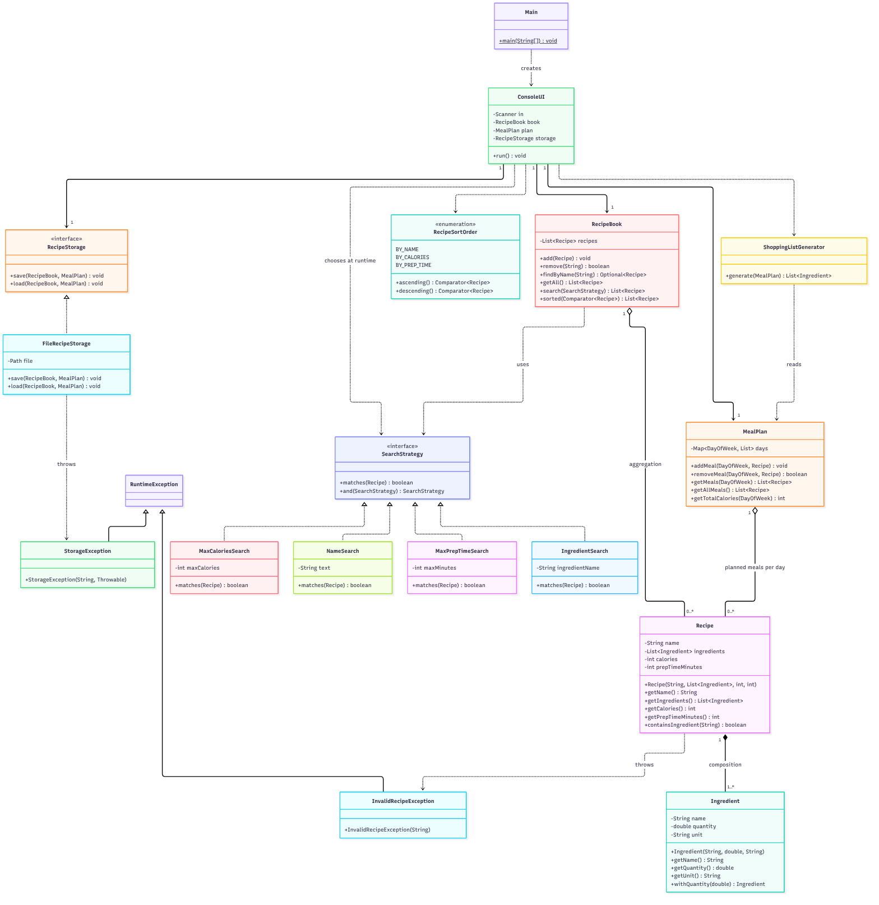

# Design documentation

| File | Contents |
|------|----------|
| [class-diagram.png](class-diagram.png) | UML class diagram (image) |
| [class-diagram.svg](class-diagram.svg) | UML class diagram (vector image) |
| [class-diagram.mmd](class-diagram.mmd) | Editable source of the diagram ([Mermaid](https://mermaid.js.org/)) |
| [user-stories.md](user-stories.md) | User stories with acceptance criteria |

To edit the diagram, change `class-diagram.mmd` and paste it into <https://mermaid.live> to export a new PNG/SVG.

